# Báo cáo thử chất lượng sửa chữ gốc (MuPDF.js 1.28.6)

Sinh tự động bởi `node spike/run.mjs` lúc 2026-11-10 06:56 UTC. Bộ mẫu: PDF tiếng Việt do Chromium xuất (phông nhúng dạng tập con như Word/Google Docs/Canva). Đây là **mẫu tổng hợp**: chứng minh cơ chế, chưa thay được bộ PDF thật.

**Kết quả: 10/11 ca đạt** đủ cả 6 tiêu chí.

| Mẫu | Ca | Sửa | Đọc chữ gốc đúng | Phông dùng | Chữ cũ bị xoá | Chữ mới đọc được (MuPDF / pdf.js) | Co ngang | Điểm ảnh đổi ngoài vùng sửa | Kết quả |
|---|---|---|---|---|---|---|---|---|---|
| s1-word-times | c1 | “12,5 tỷ đồng” → “13,2 tỷ đồng” | ✅ | Dùng lại phông gốc (LiberationSerif); gốc: LiberationSerif | ✅ | ✅ / ✅ | không | 0 | ✅ Đạt |
| s1-word-times | c2 | “các nền tảng” → “các kênh kỹ thuật số” | ✅ | Phông cùng họ (LiberationSerif-Regular); gốc: LiberationSerif | ✅ | ✅ / ✅ | 89% | 0 | ✅ Đạt |
| s1-word-times | c3 | “QUÝ 3” → “QUÝ 4” | ✅ | Phông cùng họ (LiberationSerif-Bold); gốc: LiberationSerif-Bold | ✅ | ✅ / ✅ | không | 0 | ✅ Đạt |
| s2-gdocs-arial | c1 | “15 triệu” → “18 triệu” | ✅ | Dùng lại phông gốc (LiberationSans); gốc: LiberationSans | ✅ | ✅ / ✅ | không | 0 | ✅ Đạt |
| s2-gdocs-arial | c2 | “Facebook” → “Facebook Ads” | ✅ | Phông cùng họ (LiberationSans-Regular); gốc: LiberationSans | ✅ | ✅ / ✅ | không | 0 | ✅ Đạt |
| s2-gdocs-arial | c3 | “20.000 người” → “25.000 người” | ✅ | Dùng lại phông gốc (LiberationSans); gốc: LiberationSans | ✅ | ✅ / ✅ | 99% | 0 | ✅ Đạt |
| s3-calibri-2col | c1 | “ba nguyên tắc” → “năm nguyên tắc cốt lõi” | ✅ | Phông cùng họ (Carlito-Regular); gốc: Carlito-Regular | ✅ | ✅ / ✅ | không | 0 | ✅ Đạt |
| s4-unknown-serif | c1 | “hợp đồng này” → “phụ lục kỹ thuật này” | ✅ | Phông nhận dạng (độ rộng + lượng mực) (LiberationSerif-Regular, độ rộng lệch 2.4%, mực lệch 2.4%); gốc: FreeSerif | ✅ | ✅ / ✅ | 87% | 0 | ✅ Đạt |
| s5-slide-inter | c1 | “30%” → “45%” | ✅ | Phông mượn từ chữ kề (Inter-Regular); gốc: Type3 (13 0 R) | ✅ | ✅ / ✅ | không | 0 | ✅ Đạt |
| s5-slide-inter | c2 | “2027” → “2028” | ✅ | Phông nhận dạng (độ rộng + lượng mực) (Inter-Bold, độ rộng lệch 0.8%, mực lệch 0%); gốc: Type3 (8 0 R) | ✅ | ✅ / ✅ | 97% | 0 | ✅ Đạt |
| s6-scan | c1 | “12,5 tỷ đồng” → “13,2 tỷ đồng” | ❌ | không tìm thấy chữ | — | — | — | — | ❌ Chưa |

Tiêu chí đạt: đọc đúng chữ có dấu trong file gốc; chữ cũ bị xoá khỏi lớp chữ; chữ mới đọc được bằng cả MuPDF và pdf.js; không có điểm ảnh nào đổi ngoài vùng sửa (bố cục giữ nguyên); không tràn quá mức co ngang 85%. **Độ giống phông bằng mắt** cần người xem ảnh bên dưới.

## Ảnh trước / sau

### s1-word-times · c1: Đổi số, mọi ký tự đã có trong phông gốc

Báo cáo kiểu Word, phông Times (Liberation Serif), căn đều hai bên. “12,5 tỷ đồng” → “13,2 tỷ đồng”.

| Trước | Sau |
|---|---|
| 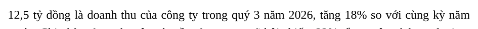 | 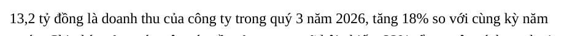 |

### s1-word-times · c2: Chữ dài hơn, có ký tự “ỹ” chưa từng xuất hiện trong file

Báo cáo kiểu Word, phông Times (Liberation Serif), căn đều hai bên. “các nền tảng” → “các kênh kỹ thuật số”.

| Trước | Sau |
|---|---|
| 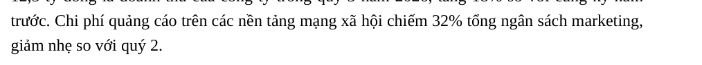 | 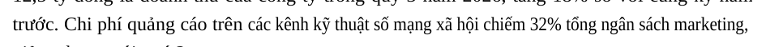 |

### s1-word-times · c3: Tiêu đề in đậm, chữ số 4 không có trong phông đậm

Báo cáo kiểu Word, phông Times (Liberation Serif), căn đều hai bên. “QUÝ 3” → “QUÝ 4”.

| Trước | Sau |
|---|---|
| 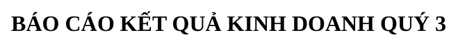 | 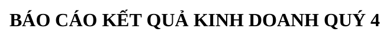 |

### s2-gdocs-arial · c1: Sửa ô bảng, cùng độ dài

Kế hoạch kiểu Google Docs, phông Arial (Liberation Sans), có bảng. “15 triệu” → “18 triệu”.

| Trước | Sau |
|---|---|
| 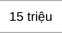 | 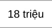 |

### s2-gdocs-arial · c2: Ô bảng, chữ dài hơn, không được tràn sang cột bên

Kế hoạch kiểu Google Docs, phông Arial (Liberation Sans), có bảng. “Facebook” → “Facebook Ads”.

| Trước | Sau |
|---|---|
|  |  |

### s2-gdocs-arial · c3: Giữa câu trong đoạn văn

Kế hoạch kiểu Google Docs, phông Arial (Liberation Sans), có bảng. “20.000 người” → “25.000 người”.

| Trước | Sau |
|---|---|
| 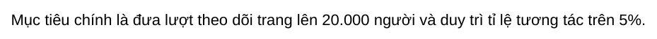 | 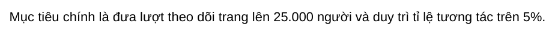 |

### s3-calibri-2col · c1: Cột trái, chữ dài hơn, không được lấn sang cột phải

Bản tin hai cột, phông Calibri (Carlito). “ba nguyên tắc” → “năm nguyên tắc cốt lõi”.

| Trước | Sau |
|---|---|
| 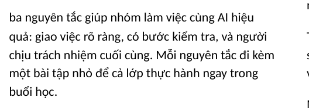 | 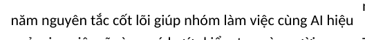 |

### s4-unknown-serif · c1: Thiếu ký tự “ỹ”, buộc thay phông khác họ

Văn bản hợp đồng, phông lạ (FreeSerif) không có trong bộ dự phòng. “hợp đồng này” → “phụ lục kỹ thuật này”.

| Trước | Sau |
|---|---|
| 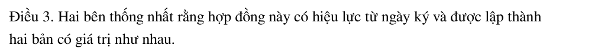 | 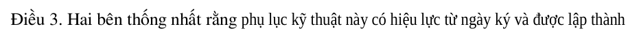 |

### s5-slide-inter · c1: Giữ màu chữ và nền, chữ số mới không có trong phông gốc

Slide nền tím chữ trắng/cam, phông Inter cỡ lớn. “30%” → “45%”.

| Trước | Sau |
|---|---|
| 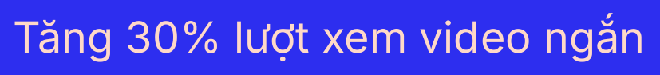 | 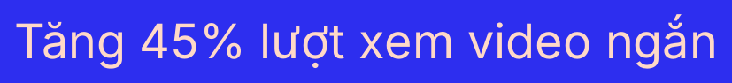 |

### s5-slide-inter · c2: Tiêu đề đậm cỡ lớn

Slide nền tím chữ trắng/cam, phông Inter cỡ lớn. “2027” → “2028”.

| Trước | Sau |
|---|---|
| 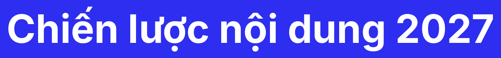 |  |

### s6-scan · c1: Không có lớp chữ: cần nhận dạng chữ (OCR) trước

Bản scan (chỉ có ảnh). “12,5 tỷ đồng” → “13,2 tỷ đồng”.

Không sửa được: file không có lớp chữ (bản scan), cần nhận dạng chữ (OCR) trước.

